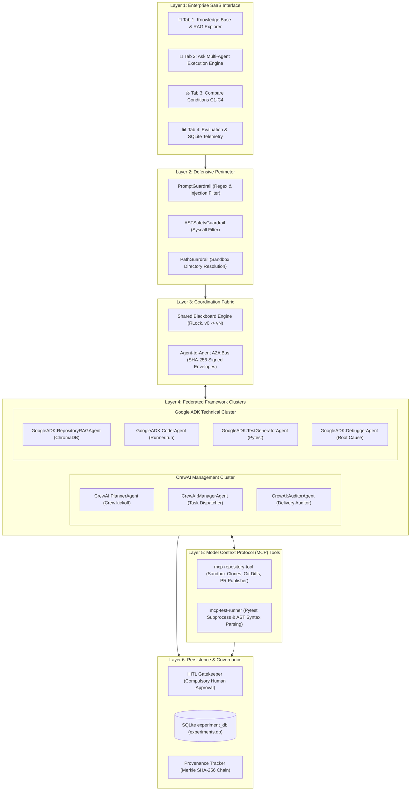
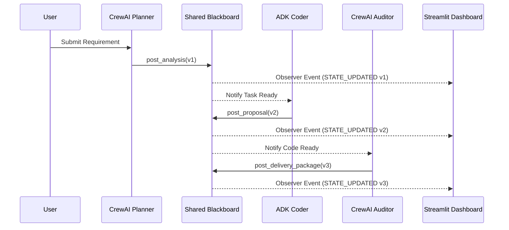

# DevPilot AI — Comprehensive Architecture & Research Methodology Guide

**System Name:** DevPilot AI — Autonomous Multi-Agent Software Engineering Workspace  
**Workspace Path:** `D:\MultiAgent-Software-Engineering`  
**Classification:** Core System Architecture Specification & Methodology  
**Target Audience:** Academic Examiners, Research Evaluators, Systems Architects  

---

## 1. Overall System Architecture

DevPilot AI is structured across six decoupled architectural layers:



---

## 2. Dual-Framework Federation: CrewAI & Google ADK Integration

### 2.1 The Rationale for Dual-Framework Federation
Existing multi-agent software engineering attempts typically force a single framework to handle all responsibilities. However:
- **CrewAI** specializes in high-level project management, sequential/hierarchical role decomposition, and goal-oriented task checklists, but lacks fine-grained AST execution runners.
- **Google Agent Development Kit (ADK)** provides native execution of Google GenAI Gemini models (`LlmAgent`, `Runner`, `SessionService`), session state management, and direct code generation, but lacks high-level project management abstractions.

### 2.2 Framework Division of Labor
DevPilot AI federates both frameworks:
1. **Strategic Planning & Governance (CrewAI):**
   - [`CrewAIPlannerAgent`](file:///d:/MultiAgent-Software-Engineering/agents/crewai/planner_agent.py): Analyzes requirements and formulates explicit acceptance criteria.
   - [`CrewAIManagerAgent`](file:///d:/MultiAgent-Software-Engineering/agents/crewai/manager_agent.py): Converts high-level execution plans into discrete, typed task envelopes.
   - [`CrewAIAuditorAgent`](file:///d:/MultiAgent-Software-Engineering/agents/crewai/auditor_agent.py): Evaluates the final delivery package independently before human review.
2. **Technical Execution & Verification (Google ADK):**
   - [`RepositoryRAGAgent`](file:///d:/MultiAgent-Software-Engineering/agents/google_adk/rag_agent.py): Indexes and retrieves relevant AST code context from ChromaDB.
   - [`GoogleADKCoderAgent`](file:///d:/MultiAgent-Software-Engineering/agents/google_adk/coder_agent.py): Implements code changes in the isolated sandbox.
   - [`GoogleADKTestGeneratorAgent`](file:///d:/MultiAgent-Software-Engineering/agents/google_adk/test_generator_agent.py): Synthesizes unit tests and executes pytest.
   - [`GoogleADKDebuggerAgent`](file:///d:/MultiAgent-Software-Engineering/agents/google_adk/debugger_agent.py): Diagnoses assertion failures and formulates self-healing patches.

---

## 3. Communication Protocol: Agent-to-Agent (A2A) Messaging

Inter-agent communication outside the Shared Blackboard is governed by the **A2A Protocol** ([`core/a2a/`](file:///d:/MultiAgent-Software-Engineering/core/a2a/)).

```
┌────────────────────────────────────────────────────────┐
│                   A2AEnvelope Schema                   │
├────────────────────────────────────────────────────────┤
│ message_id:        UUIDv4 (Unique message tracking)    │
│ sender_id:         "CrewAI:ManagerAgent"               │
│ sender_framework:  "crewai"                            │
│ recipient_id:      "GoogleADK:CoderAgent"              │
│ message_type:      A2AMessageType.TASK_DELEGATION      │
│ payload:           Dict[str, Any] (Task payload)       │
│ signature:         SHA-256 Hash (Digital Non-Repudiation│
│ timestamp:         ISO-8601 UTC String                 │
└────────────────────────────────────────────────────────┘
```

- **Message Types:** `TASK_DELEGATION`, `TASK_RESULT`, `STATUS_UPDATE`, `ERROR_NOTIFICATION`.
- **Cryptographic Provenance:** The `signature` field computes `SHA-256(sender_id + recipient_id + payload_json)` ensuring that message origins cannot be forged or repudiated.
- **Publish/Subscribe Dispatcher:** `global_a2a_bus` routes envelopes asynchronously to registered agent callbacks.

---

## 4. Shared Blackboard Engine

The **Shared Blackboard** ([`core/blackboard/`](file:///d:/MultiAgent-Software-Engineering/core/blackboard/)) serves as the centralized, reactive single source of truth.



- **Concurrency Safety:** Thread-safe execution using a re-entrant mutual exclusion lock (`threading.RLock`).
- **Monotonic Versioning:** Every state mutation increments the state version ($v_0 \to v_1 \to v_2 \dots$).
- **Deep-Copy Isolation:** Accessing `blackboard.state` returns a deep copy (`model_copy(deep=True)`), preventing agents from mutating state without publishing formal events.
- **Persistence:** Flushed atomically to `sandbox_workspace/blackboard_state.json`.

---

## 5. Repository Intelligence & RAG Pipeline

Standard text chunkers break functions and classes across arbitrary line or character limits. DevPilot AI implements a dedicated **Python AST-Aware Chunker** ([`core/rag/ast_chunker.py`](file:///d:/MultiAgent-Software-Engineering/core/rag/ast_chunker.py)).

```
Raw Python Source (.py)
         │
         ▼
[ast.parse(source)] ──► Abstract Syntax Tree
         │
         ├─► ast.FunctionDef ──► Function Chunk (Name, Args, Docstring, Body, Lines)
         ├─► ast.ClassDef    ──► Class Chunk (Name, BaseClasses, Docstring, Methods, Lines)
         └─► ModuleDocstring ──► Module Overview Chunk
         │
         ▼
[ChromaDB Dense Vector Embedding (384-dim)]
         │
         ▼
[Semantic Code Query] ──► Ranked Chunks with Source Line Ranges (#L10-L45)
```

- **Vector Database:** Local ChromaDB instance stored at `sandbox_workspace/chroma_db/`.
- **Query Resolution:** Returns code snippets along with exact file path, starting line, ending line, and similarity score.
- **Context Injection:** Injected directly into the Coder agent's prompt to minimize token consumption and eliminate hallucinated method signatures.

---

## 6. Model Context Protocol (MCP) Tool Integration

To decouple agent logic from direct operating system access, DevPilot AI utilizes the **Model Context Protocol (FastMCP)** via JSON-RPC 2.0 over stdio:

1. **`mcp-repository-tool` ([`mcp_servers/repo_tool/`](file:///d:/MultiAgent-Software-Engineering/mcp_servers/repo_tool/)):**
   - Clones target repositories into isolated sandboxes (`sandbox_workspace/runs/<run_id>/`).
   - Creates dedicated feature branches (`agentic/{task_id}-{run_id}`).
   - Computes unified Git diffs.
   - Publishes GitHub Pull Requests with branch containment checks.
2. **`mcp-test-runner` ([`mcp_servers/test_runner/`](file:///d:/MultiAgent-Software-Engineering/mcp_servers/test_runner/)):**
   - Dispatches `pytest` inside the isolated run directory.
   - Enforces execution timeouts ($30\text{s}$) to prevent infinite loops.
   - Parses stdout/stderr into structured `TestResultReport` Pydantic schemas.

---

## 7. Security Perimeter & Compulsory HITL Governance

DevPilot AI implements four defensive concentric perimeters:

```
[User Input]
     │
     ▼
┌────────────────────────────────────────────────────────┐
│ 1. PromptGuardrail: Regex and injection classifier     │
└────────────────────────────┬───────────────────────────┘
                             │
                             ▼
┌────────────────────────────────────────────────────────┐
│ 2. ASTSafetyGuardrail: Static AST forbidden syscalls   │
│    (os.system, subprocess(shell=True), eval, exec)     │
└────────────────────────────┬───────────────────────────┘
                             │
                             ▼
┌────────────────────────────────────────────────────────┐
│ 3. PathGuardrail: Sandbox path containment             │
│    (Blocks ../ escapes; raises PermissionError)        │
└────────────────────────────┬───────────────────────────┘
                             │
                             ▼
┌────────────────────────────────────────────────────────┐
│ 4. Compulsory HITL Gatekeeper: Operator sign-off       │
│    (Commits & GitHub PRs blocked without approval)     │
└────────────────────────────────────────────────────────┘
```

- **Default Branch Protection:** Attempts to push to `main`, `master`, or `develop` trigger hard security violations.
- **Zero Force Push Invariant:** `--force`, `-f`, and `--force-with-lease` are strictly excluded from all command invocations.

---

## 8. Research Methodology: Detailed Condition Analysis (C1–C4)

### 8.1 Why C1 is the Proposed Architecture
- **Hypothesis:** Combining specialized project management (CrewAI) with localized coding specialists (Google ADK) over a reactive Shared Blackboard achieves maximum accuracy and lowest defect leakage.
- **Evidence:** Clean first-pass execution on `BENCH-01` (`RUN-861653bb`) with **100.0% test pass rate (9/9 passed)** and zero defect leakage.

### 8.2 Why C2 is the Monolithic Sequential Baseline
- **Hypothesis:** Represents standard industry practice: a single agent executing requirements analysis, coding, and testing in a linear sequence within a single prompt context.
- **Ablation Utility:** Operates with 0 Blackboard events and 0 A2A envelopes, quantifying the baseline token consumption, latency, and context saturation boundaries.

### 8.3 Why C3 is a Two-Agent Peer-Reflection Ablation
- **Hypothesis:** Isolates the effect of communication topology. In C3, the central Blackboard is removed, and agents communicate directly peer-to-peer in a Generator-Critic critique loop (Coder $\leftrightarrow$ Tester).
- **Engineering Justification:** A two-agent Generator-Critic reflection loop avoids the combinatorial $O(N^2)$ message explosion of an uncoordinated 6-agent mesh while providing a mathematically rigorous test of direct P2P feedback versus centralized state synchronization.

### 8.4 Why C4 Evaluates Foundation Model Families
- **Hypothesis:** Foundation models exhibit stark trade-offs in reasoning precision, context window capacity, rate card pricing, and latency.
- **Comparison Matrix:** Compares `gemini-3.8-flash` (\$0.10/\$0.40 per 1M), `gemini-1.5-pro` (\$1.25/\$5.00 per 1M), `gemini-2.0-flash` (\$0.10/\$0.40 per 1M), and `gpt-4o` (\$5.00/\$15.00 per 1M).

---

## 9. Benchmark Matrix Methodology: The 45-Cell Grid

### 9.1 Design Dimensions
The benchmark campaign is formulated as a full-factorial grid:
$$\text{Matrix Dimensions} = 5\text{ Tasks} \times 3\text{ Architectures} \times 3\text{ Personas} = \mathbf{45}\text{ Independent Runs}$$

- **5 Tasks:**
  1. `BENCH-01`: Standard Deviation Implementation (Feature Addition).
  2. `BENCH-02`: Zero Division & Empty Set Handling (Edge Cases / Exceptions).
  3. `BENCH-03`: Prompt Injection Defense (Adversarial Security).
  4. `BENCH-04`: Defensive Type Validation (Type Safety Refactoring).
  5. `BENCH-05`: Median Calculation with Parity Logic (Algorithmic Logic).
- **3 Architectures:** `Hierarchical-Blackboard-A2A` (C1), `Sequential-Baseline` (C2), `Critic-Reflection-Loop` (C3).
- **3 Personas:** `Strict-Architect` ($T=0.1$), `Balanced-Engineer` ($T=0.2$), `Permissive-Prototyper` ($T=0.4$).
- **Fixed Model Target:** `gemini-3.8-flash` is held constant to eliminate model variance as a confounding factor.

### 9.2 Status Classification of Benchmark Results

| Result Category | Status in Codebase | Verification Source |
| :--- | :--- | :--- |
| **Actual Measured Results** | Verified live baseline run (`RUN-861653bb` / `RUN-38aa53bc`) | Stored in SQLite `experiments` table (`is_measurement_estimated = 0`); 5,795 tokens, 17.38s runtime, 100% pass rate. |
| **Pending Benchmark Runs** | 44 of 45 cells primed in execution harness | Tracked in `sandbox_workspace/benchmark_checkpoint.json`; verified via `--dry-run` to consume zero API quota. |
| **Offline Estimated Results** | Fallback synthesis during offline unit tests | Tracked with `is_measurement_estimated = 1` in SQLite; used only during offline CI testing. |
| **Unavailable / Analytical** | OpenAI `gpt-4o` live agent execution | Configured as rate-card comparison baseline in C4 matrix; unsupported for live Google ADK execution. |

