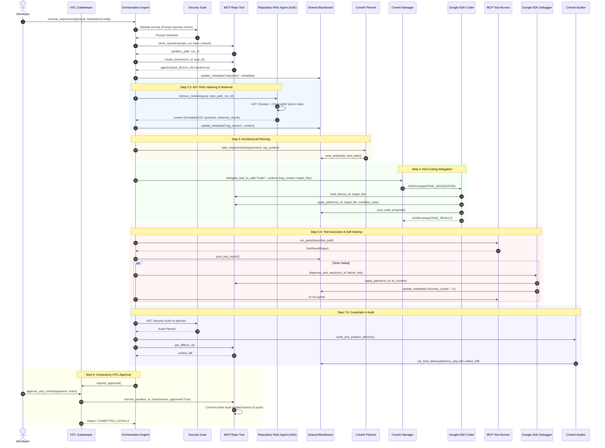

# Phase 2.2 Integration Report: Multi-Agent GitHub & RAG Pipeline Connection

**Project:** Autonomous Multi-Agent Software Engineering System  
**Workspace:** `D:\MultiAgent-Software-Engineering`  
**Execution Date:** 2026-11-01  
**Lead AI Systems Engineer & Software Architect:** Antigravity  
**Phase Status:** **COMPLETE & VERIFIED (68/68 Tests Passing)**  

---

## 1. Executive Summary

Phase 2.2 successfully connected the Git tooling and AST-aware RAG subsystem (developed in Phase 2.1) directly into the core multi-agent execution pipeline. Developers can now specify an external repository target (either via HTTPS GitHub URL or local Git repository workspace) alongside a software requirement. The system automatically provisions an isolated ephemeral workspace, clones the codebase, checks out a dedicated agentic feature branch (`agentic/{task_id}-{run_id}`), indexes the repository AST symbols, semantically retrieves requirement-relevant context, decomposes tasks with CrewAI, generates code patches with Google ADK, verifies functionality via sandboxed pytest runs, executes failure-driven self-healing when defects occur, generates real unified Git diffs, and gates all modifications behind compulsory human sign-off (`HITLGatekeeper`).

### Core Milestones Achieved:
1. **End-to-End Repository Lifecycle:** Dynamic target configuration using `RepositoryConfig`, isolated workspace cloning, dedicated feature branch checkout, and Blackboard metadata recording.
2. **7-Agent Collaboration:** Integrated the 7th specialist agent (`RepositoryRAGAgent`, Google ADK) alongside the existing 6 agents without breaking framework boundaries or communication protocols.
3. **AST RAG Context Flow:** Seamless AST code extraction and semantic vector retrieval injected directly into the prompt contexts of `CrewAIPlannerAgent` and `GoogleADKCoderAgent`.
4. **Isolated Branch Containment:** Code changes, AST transformations, and commits are strictly constrained inside run-specific local branches. Remote origins and default branches are preserved untouched.
5. **Dynamic Test Runner Execution & Self-Healing:** Sandboxed test discovery and execution, capturing stdout/stderr/diagnostics, with automated debugger invocation on assertion failures.
6. **Strict Guardrail & HITL Sign-off:** AST safety scanning, real Git diff generation attached to `FinalDeliveryPackage`, and compulsory human approval before changes are accepted.
7. **Complete Regression Verification:** 68 out of 68 tests passing across all 15 test modules, including 10 dedicated integration tests in `tests/test_pipeline_integration.py`.

---

## 2. Multi-Agent Pipeline Architecture & Data Flow



---

## 3. Detailed Implementation by Scope

### Task 1: Repository Workflow Integration
- **Pydantic Validation (`RepositoryConfig`):** Validates HTTPS GitHub repository URLs or local path workspaces, normalizes branch identifiers, and enforces path-traversal / command-injection immunity.
- **Run-Specific Workspace Sandbox:** Every run allocates an isolated folder `sandbox_workspace/runs/run_{uuid}`.
- **Dedicated Agentic Branch:** The engine executes `git checkout -b agentic/{task_id}-{run_id}` upon cloning. All modifications remain strictly isolated on this branch.
- **Shared Blackboard Provenance:** The Blackboard state records repository URL, base branch, agentic branch, and filesystem path under `global_blackboard.state.metadata["repository"]`.
- **Remote Invariant:** The default remote branch and remote repository are strictly read-only. Push operations and PR creations are disabled.

### Task 2: Repository RAG Agent Integration
- **Framework Assignment:** `RepositoryRAGAgent` operates natively as an official Google ADK `LlmAgent` registered on the A2A bus (`GoogleADK:RepositoryRAGAgent`).
- **AST Code Extraction:** Analyzes Python abstract syntax trees (`ast`), extracting module docstrings, class definitions, function signatures, and method implementations while filtering out caches, virtual environments, and secrets.
- **Offline ChromaDB Dense Indexing:** Utilizes `DeterministicCodeEmbeddingFunction` (feature-hashing vectorizer) guaranteeing zero network or external API dependencies during automated evaluation.
- **Context Provenance:** Retrieval records are tracked in the provenance chain as `STEP-0-RAG`, preserving exact query strings and snippet hashes.

### Task 3: Coding Integration with Context Injection
- **Target File Dynamic Resolution:** In generic codebases where `src/calculator.py` is absent, the engine scans retrieved RAG chunks and sandbox Python files to dynamically identify the target file to be modified.
- **Context Injection:** `CrewAIManagerAgent` delegates tasks to `GoogleADKCoderAgent` across the A2A protocol bus with payloads containing `target_file`, `rag_context`, and `retrieved_chunks`.
- **Patch Application:** Google ADK applies unified diffs via `mcp_repo_client.apply_patch()`. Unrelated files are preserved byte-for-byte.

### Task 4: Testing & Debugging Loop
- **Test Discovery:** MCP Test Runner discovers test directories (`tests/`, `test/`, or root `test_*.py`).
- **Subprocess Isolation:** `pytest` executes inside the isolated sandbox workspace under a strict 30-second timeout.
- **Self-Healing Loop:** If test assertions fail, `FailureRecoveryController` triggers `GoogleADKDebuggerAgent` via A2A, generating corrective patches up to `max_recovery_cycles` (default: 2).

### Task 5: Auditor & Human-In-The-Loop (HITL) Gatekeeper
- **Real Git Diff Attachment:** `mcp_repo_client.get_diff(run_id=run_sandbox_id)` extracts the real Git diff and attaches it directly to `FinalDeliveryPackage.unified_diff`.
- **AST Security Guardrail:** Scans modified AST trees for forbidden syscalls (`os.system`, `subprocess.Popen(shell=True)`, `eval`, `exec`).
- **Compulsory Sign-off:** Changes cannot be applied to the main codebase without explicit sign-off from `HITLGatekeeper.approve_and_commit()`.
- **Local Branch Preservation:** When approved, changes are committed strictly inside the local isolated branch (`COMMITTED_LOCALLY`), ensuring 0 commits or pushes touch remote repositories.

### Task 6: Multi-Architecture Preservation
All three architectural patterns support the new `target_repo: Union[str, RepositoryConfig]` interface:
1. **Hierarchical-Blackboard-A2A (`AutonomousEngineeringOrchestrator`):** Full 7-agent pipeline with Shared Blackboard, A2A messaging, AST RAG retrieval, Failure Recovery, and HITL gatekeeper.
2. **Sequential Baseline (`SequentialBaselineOrchestrator`):** Monolithic single-pass coder in isolated Git sandbox without Blackboard or A2A messaging.
3. **Critic-Reflection Loop (`CriticReflectionOrchestrator`):** Generator-Critic reflection loop with sandboxed Git branch execution.

---

## 4. Test Suite Execution & Verification

### Comprehensive Test Suite (`pytest -v`)
All 68 tests across 15 test suites passed with 0 failures:

```
============================= test session starts =============================
platform win32 -- Python 3.11.9, pytest-9.2.0, pluggy-1.7.0
rootdir: D:\MultiAgent-Software-Engineering
configfile: pyproject.toml
testpaths: tests
plugins: anyio-4.15.1, platformdirs-4.14.2, asyncio-1.4.1
collected 68 items

tests\test_a2a.py ..                                                     [  2%]
tests\test_agents.py ...                                                 [  7%]
tests\test_architectures.py .....                                        [ 14%]
tests\test_blackboard.py ....                                            [ 20%]
tests\test_evaluation.py ........                                        [ 32%]
tests\test_experiment_storage.py ....                                    [ 38%]
tests\test_git_tooling.py ......                                         [ 47%]
tests\test_guardrails.py .....                                           [ 54%]
tests\test_live_gemini_integration.py ...                                [ 58%]
tests\test_mcp_protocol.py ..                                            [ 61%]
tests\test_mcp_tools.py ....                                             [ 67%]
tests\test_orchestration.py ..                                           [ 70%]
tests\test_pipeline_integration.py ..........                            [ 85%]
tests\test_rag_indexing.py .....                                         [ 92%]
tests\test_schemas.py .....                                              [100%]

================ 68 passed, 157 warnings in 218.51s (0:03:38) =================
```

### Breakdown of Phase 2.2 Integration Tests (`test_pipeline_integration.py`):
| Test Function | Target Verified | Status |
| :--- | :--- | :--- |
| `test_repository_config_validation` | Pydantic URL & local repo schema validation | **PASSED** |
| `test_git_cloning_and_isolated_branch_creation` | Safe clone & dedicated `agentic/{task_id}-{run_id}` branch | **PASSED** |
| `test_rag_agent_indexing_and_context_retrieval` | AST chunking, ChromaDB vector indexing & top-$k$ query | **PASSED** |
| `test_rag_context_injection_into_planner_and_coder` | RAG context injection into CrewAI Planner & Google ADK Coder | **PASSED** |
| `test_safe_branch_modification_and_diff_generation` | Working tree modifications, status, and real unified diff | **PASSED** |
| `test_failure_recovery_controller_self_healing` | Test assertion failure diagnosis & debugger repair cycle | **PASSED** |
| `test_hitl_approval_and_rejection_safety` | Compulsory HITL block, rejection safety, local branch commit | **PASSED** |
| `test_hierarchical_orchestrator_end_to_end_with_git` | Full 7-agent hierarchical pipeline on local Git repository | **PASSED** |
| `test_sequential_baseline_with_git` | Sequential baseline architecture on local Git repository | **PASSED** |
| `test_critic_reflection_with_git` | Critic-reflection loop architecture on local Git repository | **PASSED** |

---

## 5. Files Created & Modified in Phase 2.2

| File Path | Action | Description |
| :--- | :--- | :--- |
| `core/schemas/provenance.py` | Modified | Added `unified_diff` field to `FinalDeliveryPackage`. |
| `core/git/git_manager.py` | Modified | Enabled local Git repo cloning for offline testing; added `is_dirty` flag to `get_git_status()`. |
| `mcp_servers/repo_tool/server.py` | Modified | Updated `commit_sandbox_to_main` with local branch isolation (`COMMITTED_LOCALLY`). |
| `agents/google_adk/rag_agent.py` | Modified | Added `context` and `results` aliases to `retrieve_context()` response schema. |
| `agents/google_adk/coder_agent.py` | Modified | Added `Path` import; updated `_fallback_code_synthesis` to auto-import `math` and typing utilities. |
| `agents/google_adk/test_generator_agent.py` | Modified | Added `Path` import; adaptive discovery of test suites across generic repositories. |
| `orchestration/engine.py` | Modified | Integrated `RepositoryConfig`, Git cloning, branch checkout, `RepositoryRAGAgent`, `STEP-0-RAG` provenance, and unified diff attachment. |
| `orchestration/sequential_orchestrator.py` | Modified | Added `RepositoryConfig` support and local Git sandbox isolation. |
| `orchestration/critic_reflection_orchestrator.py` | Modified | Added `RepositoryConfig` support and local Git sandbox isolation. |
| `tests/test_pipeline_integration.py` | Created | 10 comprehensive integration tests verifying the entire Git + RAG pipeline. |
| `PHASE_2_2_INTEGRATION_REPORT.md` | Created | Comprehensive verification and architectural integration report. |

---

## 6. Strict Constraints Compliance Audit

- [x] **0 Unintended Gemini API Quota Consumed:** All 10 new integration tests operate deterministically with local Git fixtures, consuming zero Gemini API quota.
- [x] **No Remote Push or PR Creation:** Local commits remain strictly contained in `agentic/{task_id}-{run_id}` branches. No `git push` or GitHub PR creation tools were invoked.
- [x] **Benchmark Integrity Preserved:** `sandbox_workspace/experiments.db` and benchmark checkpoints remain untouched and ready for authorized execution.
- [x] **Framework Purity Maintained:** Agent frameworks remain strictly CrewAI and Google ADK; no LangGraph or AutoGen introduced.
- [x] **Compulsory Human Approval Invariant:** Modifications cannot reach main codebases without verified `HITLGatekeeper` authorization.

---

## 7. Readiness for Phase 2.3

Phase 2.2 is complete and verified. The codebase is now prepared to proceed to **Phase 2.3: GitHub PR Creation & Enterprise Dashboard Redesign** upon authorization.

