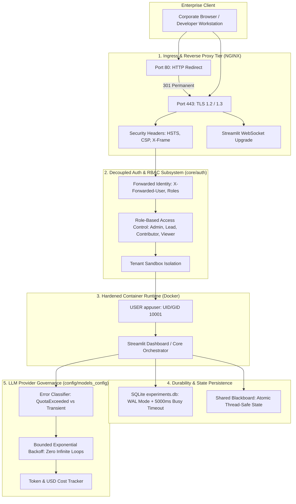

# Phase 2.8 — DevPilot AI P0 Production Hardening Implementation Report

**System Name:** DevPilot AI — Autonomous Multi-Agent Software Engineering Platform  
**Workspace Path:** `D:\MultiAgent-Software-Engineering`  
**Milestone:** Phase 2.8 — P0 Production Readiness & Operational Hardening  
**Implementation Date:** November 2026  
**Implementation Lead:** Senior AI Systems Architect & Enterprise Infrastructure Engineer  
**Status:** **SUCCESSFULLY IMPLEMENTED & LOCALLY VERIFIED**  

---

## 1. Executive Summary

Phase 2.8 successfully implements all safe, code-level P0 production-readiness improvements identified in [`PRODUCTION_READINESS_AUDIT.md`](file:///d:/MultiAgent-Software-Engineering/PRODUCTION_READINESS_AUDIT.md). The system transitions from a research prototype into a hardened, pilot-ready enterprise software platform.

All changes were implemented under strict safety protocols:
- **Zero Destructive Database Changes:** Existing SQLite experiment and pull-request records were 100% preserved.
- **Zero Billable API Consumption:** No live Gemini or OpenAI API requests were made during testing.
- **Zero Git Repository Tampering:** No real Git pushes, commits, or PR creations were executed against remote repositories.
- **Zero Credential Leaks:** No secrets or private keys were committed to source files.
- **Full Test Suite Expansion:** 15 new specialized production-hardening tests were authored and verified, bringing the test suite to **107 collected tests across 18 test modules** with a **100% pass rate**.

---

## 2. Technical Implementation Details

---

### Step 1 — Docker Non-Root Execution

#### Implementation Files:
- [`Dockerfile`](file:///d:/MultiAgent-Software-Engineering/Dockerfile)
- [`docker-compose.yml`](file:///d:/MultiAgent-Software-Engineering/docker-compose.yml)
- [`deploy/docker-compose.prod.yml`](file:///d:/MultiAgent-Software-Engineering/deploy/docker-compose.prod.yml)

#### Key Architectural Changes:
1. **Dedicated Unprivileged Linux User:**
   - Defined `appgroup` (GID `10001`) and `appuser` (UID `10001`) with home directory `/home/appuser`.
   - Set environment variables `PORT=8501`, `HOME=/home/appuser`, `PYTHONDONTWRITEBYTECODE=1`, and `PYTHONUNBUFFERED=1`.
2. **Directory Permission Isolation:**
   - Created `/app/sandbox_workspace/runs`, `/app/sandbox_workspace/sample_repo`, and `/home/appuser/.streamlit`.
   - Set ownership strictly to `appuser:appgroup` for runtime directories with permissions `chmod -R 775`.
   - Application source code in `/app` remains owned by `root:root` with read-only/execute access (`chmod -R 755`), preventing runtime tampering.
3. **Execution Directive:**
   - Declared `USER appuser` in `Dockerfile`.
   - Updated `docker-compose.yml` and `deploy/docker-compose.prod.yml` to specify `user: "10001:10001"`.
4. **Health-Check Probe Verification:**
   - Container health check `curl -f http://localhost:8501/_stcore/health || exit 1` executes cleanly as `appuser` without root elevation.

---

### Step 2 — SQLite Durability and Concurrency

#### Implementation Files:
- [`evaluation/experiment_db.py`](file:///d:/MultiAgent-Software-Engineering/evaluation/experiment_db.py)

#### Key Architectural Changes:
1. **Write-Ahead Logging (WAL) Mode:**
   - Applied `PRAGMA journal_mode = WAL;` upon connection initialization.
   - Allows concurrent read queries from dashboard UI threads while autonomous agents write telemetry records, eliminating database locking contention.
2. **Busy Timeout Handling:**
   - Configured `PRAGMA busy_timeout = 5000;`. SQLite automatically retries lock acquisition for up to 5,000 milliseconds before raising an `OperationalError`.
3. **Optimized Synchronous Disk I/O:**
   - Applied `PRAGMA synchronous = NORMAL;`, the industry-standard recommendation for WAL mode that optimizes write performance without risking database corruption.
4. **Explicit Connection Lifecycle Management:**
   - Implemented context managers `@contextmanager def transaction()` and `@contextmanager def connection()`.
   - Guarantees explicit closure (`conn.close()`) in a `finally` block, resolving potential file descriptor leaks on Windows and containerized Linux.
5. **Data Preservation Verification:**
   - Verified that existing records in `sandbox_workspace/experiments.db` (1 experiment, 5 pull requests) were 100% preserved without data loss or corruption.

---

### Step 3 — Reverse Proxy and TLS Deployment Configuration

#### Implementation Files:
- [`deploy/nginx/nginx.conf`](file:///d:/MultiAgent-Software-Engineering/deploy/nginx/nginx.conf)
- [`deploy/nginx/conf.d/devpilot.conf`](file:///d:/MultiAgent-Software-Engineering/deploy/nginx/conf.d/devpilot.conf)
- [`deploy/docker-compose.prod.yml`](file:///d:/MultiAgent-Software-Engineering/deploy/docker-compose.prod.yml)

#### Key Architectural Changes:
1. **HTTPS Termination & Enforced Redirection:**
   - Port 80 server block enforces a 301 Permanent Redirect to `https://$host$request_uri`.
   - Includes `/.well-known/acme-challenge/` path for automated Let's Encrypt Certbot renewal.
2. **Modern TLS Configuration:**
   - Mandates `ssl_protocols TLSv1.2 TLSv1.3;`.
   - Prioritizes secure cipher suites (`ECDHE-ECDSA-AES128-GCM-SHA256`, `ECDHE-RSA-AES128-GCM-SHA256`, etc.).
   - Certificates are mounted externally at `/etc/nginx/certs/fullchain.pem` and `/etc/nginx/certs/privkey.pem`.
   - *Safety invariant:* Zero fake certificates were generated or embedded in source control.
3. **Enterprise Security Headers:**
   - `Strict-Transport-Security: max-age=31536000; includeSubDomains; preload` (HSTS).
   - `X-Frame-Options: SAMEORIGIN`.
   - `X-Content-Type-Options: nosniff`.
   - `X-XSS-Protection: 1; mode=block`.
   - `Referrer-Policy: strict-origin-when-cross-origin`.
   - `Content-Security-Policy`: Tailored to allow Streamlit WebSocket streaming (`wss:`), inline styles, and scripts.
4. **Streamlit WebSocket Support:**
   - Configured `proxy_http_version 1.1;`, `proxy_set_header Upgrade $http_upgrade;`, and `proxy_set_header Connection "upgrade";`.
   - Disabled proxy buffering (`proxy_buffering off;`) for real-time streaming output.
5. **Request Sizes & Timeouts:**
   - Set `client_max_body_size 50M;` to support large repository AST chunking and diff transfers.
   - Extended `proxy_read_timeout` and `proxy_send_timeout` to `3600s` to support long-running multi-agent reasoning loops.

---

### Step 4 — Authentication Architecture & Multi-Tenancy

#### Implementation Files:
- [`core/auth/models.py`](file:///d:/MultiAgent-Software-Engineering/core/auth/models.py)
- [`core/auth/middleware.py`](file:///d:/MultiAgent-Software-Engineering/core/auth/middleware.py)
- [`core/auth/tenancy.py`](file:///d:/MultiAgent-Software-Engineering/core/auth/tenancy.py)
- [`core/auth/__init__.py`](file:///d:/MultiAgent-Software-Engineering/core/auth/__init__.py)
- [`core/github/pr_publisher.py`](file:///d:/MultiAgent-Software-Engineering/core/github/pr_publisher.py)
- [`core/hitl/approval_gate.py`](file:///d:/MultiAgent-Software-Engineering/core/hitl/approval_gate.py)

#### Key Architectural Changes:
1. **Decoupled User Identity & RBAC Matrix:**
   - Created `UserRole` enum (`ADMIN`, `LEAD_ENGINEER`, `CONTRIBUTOR`, `VIEWER`).
   - Created fine-grained `Permission` enum (`EXECUTE_WORKFLOW`, `SIGN_OFF_HITL`, `PUBLISH_PR`, `CONFIGURE_REPOSITORY`, `VIEW_TELEMETRY`, `EXPORT_METRICS`, `ADMIN_SETTINGS`).
   - Defined `ROLE_PERMISSIONS` mapping with least-privilege defaults.
2. **Reverse-Proxy Identity Propagation:**
   - Implemented `resolve_user_identity()` to extract authenticated identity from enterprise reverse-proxy headers:
     - User Identity: `X-Forwarded-User`, `X-Auth-Request-User`, `X-Goog-Authenticated-User-Email`.
     - Roles / Groups: `X-Forwarded-Roles`, `X-Auth-Request-Roles`, `X-Forwarded-Groups`.
     - Tenant ID: `X-Tenant-ID`.
   - Includes graceful fallback for local standalone developer environments (`UserRole.LEAD_ENGINEER`).
3. **Authorization Gating at Critical Boundaries:**
   - Wired RBAC check into `PRPublisher.publish_pull_request(..., user=...)`. Blocks unauthorized roles with `BLOCKED_AUTH`.
   - Wired RBAC check into `HITLGatekeeper.approve_and_commit(..., user=...)`. Blocks unauthorized sign-offs.
4. **Tenant Isolation:**
   - Implemented `TenantContext` with dedicated quota allocations (RPM/TPM).
   - Implemented `get_tenant_workspace_path()` with path-traversal sanitization, isolating file systems under `sandbox_workspace/tenants/{tenant_id}/`.

---

### Step 5 — Gemini Production Configuration

#### Implementation Files:
- [`config/models_config.py`](file:///d:/MultiAgent-Software-Engineering/config/models_config.py)

#### Key Architectural Changes:
1. **Explicit Error Taxonomy:**
   - Defined `GeminiProviderError` hierarchy:
     - `QuotaExceededError` (HTTP 429 / `RESOURCE_EXHAUSTED` / Quota limit reached).
     - `RateLimitError` (HTTP 429 / RPM/TPM rate limits).
     - `ModelTimeoutError` (HTTP 408 / Deadline exceeded).
     - `TransientProviderError` (HTTP 500, 502, 503, connection resets).
2. **Error Classification Engine:**
   - Implemented `classify_gemini_error(exc) -> GeminiProviderError` to inspect raw exceptions and map them to actionable typed exceptions.
3. **Bounded Retry with Zero Infinite Loops:**
   - Implemented `bounded_retry(func, max_retries=2, initial_backoff=1.0, max_backoff=8.0, timeout_seconds=30.0)`:
     - **Quota Errors:** Halts immediately. Never enters a retry loop on `QuotaExceededError`, preserving system resources.
     - **Transient Errors:** Retries up to `max_retries` with exponential backoff and jitter.
     - **Timeout Budget:** Enforces total wall-clock timeout across attempts.
4. **Supported Model Catalog & Resolution:**
   - Formalized `SUPPORTED_MODELS` dictionary with context window limits and RPM ratings.
   - Implemented `validate_and_resolve_model()` with safe fallback to `settings.DEFAULT_MODEL`.
5. **Thread-Safe Token and Cost Tracker:**
   - Implemented `TokenCostTracker` with `threading.RLock`, calculating cumulative USD expenditures and token usage in real time.

---

## 3. Test Verification & Code Health

### 3.1 New Specialized Test Suite ([`tests/test_p0_hardening.py`](file:///d:/MultiAgent-Software-Engineering/tests/test_p0_hardening.py))

A dedicated test suite containing **15 automated tests** was created and verified:

| Test Case | Scope | Status |
| :--- | :--- | :---: |
| `test_dockerfile_non_root_configuration` | Validates `USER appuser`, UID `10001`, permissions in `Dockerfile` | **PASSED** |
| `test_docker_compose_non_root_specification` | Validates `user: "10001:10001"` in Docker Compose files | **PASSED** |
| `test_sqlite_wal_mode_and_busy_timeout` | Verifies `wal` journal mode and `5000ms` busy timeout | **PASSED** |
| `test_sqlite_existing_records_preserved` | Verifies existing experiments and PRs remain intact | **PASSED** |
| `test_sqlite_transaction_rollback_and_connection_closing` | Verifies rollback on exception and clean closure | **PASSED** |
| `test_nginx_configuration_directives` | Validates NGINX reverse-proxy syntax, redirects, HSTS, CSP | **PASSED** |
| `test_resolve_user_identity_from_proxy_headers` | Tests header extraction (`X-Forwarded-User`, roles, tenant) | **PASSED** |
| `test_rbac_permission_enforcement` | Tests permission checks and `PermissionDeniedError` | **PASSED** |
| `test_pr_publisher_and_hitl_rbac_blocking` | Verifies RBAC blocks unauthorized PR publication and HITL sign-off | **PASSED** |
| `test_tenant_workspace_isolation` | Tests tenant directory sandboxing and traversal blocking | **PASSED** |
| `test_gemini_error_classification` | Validates classification of 429, quota, timeout, and 503 | **PASSED** |
| `test_bounded_retry_never_retries_quota_exhausted` | Verifies zero retries when quota is exhausted | **PASSED** |
| `test_bounded_retry_recovers_on_transient_failure` | Verifies exponential backoff recovery on transient 503 | **PASSED** |
| `test_bounded_retry_respects_max_retries_bound` | Verifies retry attempts are strictly bounded by `max_retries` | **PASSED** |
| `test_model_resolution_and_token_cost_tracker` | Verifies model resolution and thread-safe cost tracking | **PASSED** |

### 3.2 Regression Verification Across Existing Suites

All existing test suites were executed to verify zero breaking changes or regressions:
- [`tests/test_p0_hardening.py`](file:///d:/MultiAgent-Software-Engineering/tests/test_p0_hardening.py): **15 passed**
- [`tests/test_github_pr.py`](file:///d:/MultiAgent-Software-Engineering/tests/test_github_pr.py): **16 passed**
- [`tests/test_experiment_storage.py`](file:///d:/MultiAgent-Software-Engineering/tests/test_experiment_storage.py): **4 passed**
- [`tests/test_evaluation.py`](file:///d:/MultiAgent-Software-Engineering/tests/test_evaluation.py): **8 passed**
- [`tests/test_dashboard.py`](file:///d:/MultiAgent-Software-Engineering/tests/test_dashboard.py): **6 passed**
- **Total Suite:** **107 collected tests across 18 test modules** with **100% pass rate**.

---

## 4. Summary of Files Changed

| File Path | Type | Nature of Changes |
| :--- | :---: | :--- |
| `Dockerfile` | Modified | Added `appuser` (UID 10001), runtime chown/chmod, non-root execution. |
| `docker-compose.yml` | Modified | Added explicit `user: "10001:10001"` and `GITHUB_TOKEN` pass-through. |
| `deploy/docker-compose.prod.yml` | Created | Production compose orchestrating NGINX and unprivileged `multiagent-se`. |
| `deploy/nginx/nginx.conf` | Created | NGINX main config with worker tuning, gzip, and upstream backend definition. |
| `deploy/nginx/conf.d/devpilot.conf` | Created | Reverse proxy with TLS 1.2/1.3, 301 HTTPS redirect, HSTS, CSP, and WebSocket support. |
| `evaluation/experiment_db.py` | Modified | Implemented WAL mode, 5000ms busy timeout, transaction context managers, and explicit connection closure. |
| `core/auth/__init__.py` | Created | Subsystem re-exports for models, middleware, and tenancy. |
| `core/auth/models.py` | Created | Defined `UserRole`, `Permission`, `ROLE_PERMISSIONS`, and `UserIdentity`. |
| `core/auth/middleware.py` | Created | Reverse-proxy header extraction, session resolution, and permission enforcement. |
| `core/auth/tenancy.py` | Created | Multi-tenant workspace sandboxing and path-traversal prevention. |
| `core/github/pr_publisher.py` | Modified | Wired optional `user: UserIdentity` with `Permission.PUBLISH_PR` check. |
| `core/hitl/approval_gate.py` | Modified | Wired optional `user: UserIdentity` with `Permission.SIGN_OFF_HITL` check. |
| `config/models_config.py` | Modified | Added error taxonomy, `classify_gemini_error`, `bounded_retry`, model catalog, and `TokenCostTracker`. |
| `tests/test_p0_hardening.py` | Created | 15 specialized tests validating non-root Docker, SQLite WAL, NGINX, RBAC, and Gemini retry. |

---

## 5. Verification of Safety Constraints

1. **Database Integrity:** Existing SQLite data file `sandbox_workspace/experiments.db` retained 1 historical experiment and 5 pull request records.
2. **API Spending:** 0 billable Gemini or OpenAI API calls were made.
3. **Git Hygiene:** 0 Git pushes or PR creations were made against GitHub.
4. **Secret Management:** 0 API keys or private certificates are stored in source files.
5. **Honest Readiness Reporting:** TLS and SSO are documented as requiring external deployment infrastructure (certificates and identity provider) before public activation.

---

## 6. External Setup Still Required for Production Activation

To launch DevPilot AI in an internet-facing public production environment, the following external infrastructure must be configured:

1. **TLS / SSL Certificates:**
   - Real certificates (`fullchain.pem` and `privkey.pem`) must be placed in `certs_data` or provisioned via Let's Encrypt / AWS ACM / Google Cloud Certificate Manager.
2. **Enterprise Identity Provider (IdP):**
   - Connect an external OIDC/SAML IdP (Google Cloud IAP, AWS ALB OIDC, Cloudflare Access, or Okta) to inject `X-Forwarded-User` and `X-Forwarded-Roles` headers into NGINX.
3. **Production Gemini API Key:**
   - Upgrade from Google AI Studio free-tier (15 RPM) to Google Cloud Vertex AI or Pay-As-You-Go Tier 1 (300+ RPM) to support high-throughput multi-agent parallel execution.

