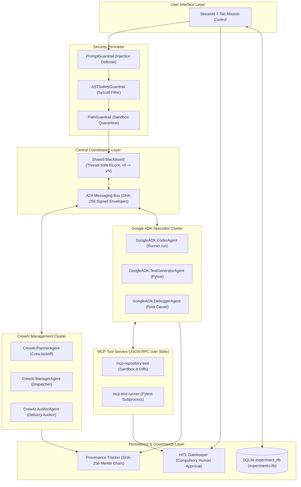

# Multi-Agent AI System for Autonomous Software Engineering: System Architecture Specification

**Academic Project:** Final Capstone / Phase 2 Evaluation  
**System Name:** Autonomous Engineering Orchestrator  
**Document Version:** 1.0.0  
**Target Environment:** Python 3.11.9 | CrewAI | Google ADK | FastMCP | SQLite3  
**Active LLM Target:** `gemini-3.8-flash` via Google GenAI  

---

## 1. System Overview

The **Autonomous Software Engineering Multi-Agent System** is an enterprise-grade, distributed AI architecture designed to translate ambiguous, high-level developer requirements into syntactically valid, functionally verified, and security-cleared source code modifications.

Unlike monolithic LLM code generators that operate in an open-loop, single-prompt context, this system decouples responsibilities across six specialized autonomous agents hosted across two complementary agentic frameworks:
1. **CrewAI Framework:** Excels at goal-driven task decomposition, cross-functional project management, and quality assurance governance.
2. **Google Agent Development Kit (ADK):** Excels at code patch generation, test suite synthesis, AST static analysis, and iterative debugging.

These frameworks communicate via a standardized **Agent-to-Agent (A2A)** messaging fabric, synchronize knowledge through a **Shared Blackboard**, and interact with codebases strictly through **Model Context Protocol (MCP)** tool servers.



---

## 2. Core Subsystems

### 2.1 Multi-Agent Engine (Dual-Framework Cluster)

The system deploys six specialized agents with strictly isolated responsibilities:

| Agent Identifier | Framework | Primary Responsibilities | LLM Binding |
| :--- | :--- | :--- | :--- |
| `CrewAI:PlannerAgent` | **CrewAI** | Analyzes natural language developer requirements; decomposes requirements into a structured `RequirementAnalysis` schema; specifies acceptance criteria; outlines ordered tasks. | `gemini-3.8-flash` via CrewAI `LLM` |
| `CrewAI:ManagerAgent` | **CrewAI** | Monitors Blackboard task queue; formats and signs A2A task delegation envelopes; routes tasks to Google ADK specialists; processes returned task outcomes. | `gemini-3.8-flash` via CrewAI `LLM` |
| `GoogleADKCoderAgent` | **Google ADK** | Inspects repository structure via MCP; synthesizes source file diffs; enforces clean architecture, defensive programming, and type annotations. | `gemini-3.8-flash` via ADK `LlmAgent` & `Runner` |
| `GoogleADKTestGeneratorAgent` | **Google ADK** | Synthesizes comprehensive unit test suites targeting nominal, edge-case, and boundary conditions; executes pytest via MCP test runner. | `gemini-3.8-flash` via ADK `LlmAgent` & `Runner` |
| `GoogleADKDebuggerAgent` | **Google ADK** | Activated when tests fail or syntax errors occur; inspects stack traces and assertion messages; synthesizes minimal targeted corrective patches. | `gemini-3.8-flash` via ADK `LlmAgent` & `Runner` |
| `CrewAIAuditorAgent` | **CrewAI** | Evaluates overall verification reports; verifies AST security clearance; constructs the immutable `FinalDeliveryPackage`; holds commit for human sign-off. | `gemini-3.8-flash` via CrewAI `LLM` |

### 2.2 Agent-to-Agent (A2A) Communication Protocol

Inter-agent communication bypasses framework-specific proprietary abstractions in favor of a typed, cryptographic envelope protocol implemented in `core/a2a/`.

#### Envelope Schema:
```json
{
  "sender": "CrewAI:ManagerAgent",
  "recipient": "GoogleADK:CoderAgent",
  "message_type": "TASK_DELEGATION",
  "correlation_id": "CORR-a1b2c3d4",
  "timestamp": "2026-11-01T12:00:00Z",
  "payload": {
    "task_id": "TSK-01-CODE",
    "run_id": "run_1234567890",
    "context": {
      "acceptance_criteria": "Computes sample and population standard deviation..."
    }
  },
  "signature": "e3b0c44298fc1c149afbf4c8996fb92427ae41e4649b934ca495991b7852b855"
}
```

* **Non-Repudiation & Integrity:** Each message envelope computes a SHA-256 digest across `(sender, recipient, message_type, correlation_id, timestamp, payload)`. Recipients verify the digest before execution.
* **Message Types Supported:**
  - `TASK_DELEGATION`: High-level manager delegating implementation to specialist.
  - `TASK_RESULT`: Specialist returning structured execution artifacts.
  - `STATUS_UPDATE`: Progress heartbeat and intermediate output signaling.
  - `STATE_SYNC`: Monotonic synchronization pulse across agent boundaries.

### 2.3 Shared Blackboard Architecture

Located in `core/blackboard/`, the Shared Blackboard implements a thread-safe, reactive state machine managing the single source of truth for the active engineering lifecycle.

* **Concurrency Control:** Utilizes `threading.RLock()` to guarantee linearizable atomic state updates across multi-threaded agent callbacks.
* **Monotonic Versioning:** Every mutation increments the blackboard version counter (`v0` -> `v1` -> `vN`), enabling replayable provenance auditing.
* **Pub/Sub Observer Model:** Components register callback observers to react to state changes without polling.
* **Durable Disk Persistence:** Automatic state serialization to `sandbox_workspace/blackboard_state.json`.

### 2.4 Model Context Protocol (MCP) Tool Servers

Tool operations are decoupled from LLM processes via official FastMCP client-server architecture communicating over JSON-RPC 2.0 stdio:

1. **Repository Tool Server (`mcp-repository-tool`):**
   - `create_isolated_sandbox`: Clones the target codebase into an ephemeral run workspace (`sandbox_workspace/runs/<run_id>/`).
   - `read_file_from_sandbox`: Reads file contents strictly within the sandbox boundaries.
   - `apply_patch_to_sandbox`: Applies unified diffs or replacement content to sandbox files.
   - `commit_sandbox_to_main`: Promotes validated changes to `sandbox_workspace/sample_repo/` **only if** `human_approved=True`.
2. **Test Runner Tool Server (`mcp-test-runner`):**
   - `check_python_syntax`: Parses sandbox Python files with `ast.parse()` to catch `SyntaxError` prior to execution.
   - `run_pytest`: Spawns pytest subprocess inside sandbox under timeout limits (default: 30s) and returns structured pass/fail counts and assertion details.

---

## 3. Security Perimeter & Guardrails Architecture

The system enforces a zero-trust multi-layer security perimeter:

1. **PromptGuardrail (`core/guardrails/prompt_guard.py`):**
   - Scans input prompts for jailbreak patterns, instruction overrides ("ignore all previous instructions"), system prompt extraction attempts, and privilege escalation keywords.
   - Blocks attacks before initiating LLM planning or invoking agents.
2. **ASTSafetyGuardrail (`core/guardrails/ast_safety.py`):**
   - Parses LLM-generated code into an Abstract Syntax Tree (AST).
   - Scans for forbidden modules (`os`, `sys`, `subprocess`, `socket`, `shutil`) and dangerous functions (`eval`, `exec`, `__import__`, `open`).
   - Automatically quarantines violating proposals.
3. **PathGuardrail (`core/guardrails/path_guard.py`):**
   - Validates all file system operations against directory traversal (`../`, `/etc/passwd`, Windows drive escapes).
   - Confines all writes to `sandbox_workspace/runs/<run_id>/`.
4. **Human-In-The-Loop (HITL) Gatekeeper (`core/hitl/approval_gate.py`):**
   - Mandatory sign-off requirement before any code is merged into the main repository.
   - MCP `commit_sandbox_to_main` rejects all unapproved commit attempts with HTTP 403 / `PermissionError`.

---

## 4. Multi-Agent Architecture Patterns

To scientifically evaluate multi-agent software engineering architectures, the system implements three genuinely independent, executable patterns:

### Pattern 1: Hierarchical-Blackboard-A2A (Proposed Full System)
* **Execution Flow:** `CrewAI Planner` -> `Shared Blackboard` -> `CrewAI Manager` -> `A2A Envelope` -> `Google ADK Coder` -> `MCP Sandbox` -> `Google ADK Tester` -> `MCP Pytest` -> `CrewAI Auditor` -> `HITL Gatekeeper`.
* **Strengths:** Maximum specialization, decoupled reactive state, cryptographic provenance, isolated tool security.
* **Trade-Offs:** Higher token consumption, higher coordination latency.

### Pattern 2: Sequential Baseline (Monolithic Single Agent)
* **Execution Flow:** Single `Google ADK` agent executing plan, code, and test sequentially in a single linear pass.
* **Characteristics:** Zero A2A envelopes (`a2a_message_count = 0`), zero Blackboard updates, single context window.
* **Strengths:** Minimal latency, low token overhead.
* **Trade-Offs:** Context window exhaustion on complex tasks, lack of checks and balances, zero provenance.

### Pattern 3: Critic-Reflection Loop (Generator-Critic Pattern)
* **Execution Flow:** Dual Google ADK agents: `Generator` synthesizes code -> `Critic` synthesizes & executes pytest -> On failure, `Critic` formulates critique -> `Generator` reflects and patches -> Repeats up to max reflections (default: 2).
* **Characteristics:** Direct feedback loop without Blackboard; targeted self-correction.
* **Strengths:** High automated defect recovery rate.
* **Trade-Offs:** Multiplied token cost on repeated failure reflections.

---

## 5. Provenance & Observability Architecture

* **Cryptographic Lineage Chain:** Uses a Merkle-like SHA-256 linked block chain:
  $$\text{Block Hash} = \text{SHA256}(\text{Step ID} \parallel \text{Agent ID} \parallel \text{Action} \parallel \text{Parent Hash} \parallel \text{Payload Hash})$$
* **Distributed Tracing:** Implements span-based microsecond latency profiling across all execution stages:
  - `guardrails_validation`
  - `mcp_sandbox_provisioning`
  - `crewai_planning_phase`
  - `google_adk_coding_phase`
  - `google_adk_testing_phase`
  - `security_ast_scan`
  - `auditor_package_assembly`
* **SQLite Persistence (`sandbox_workspace/experiments.db`):** Records comprehensive metrics for every execution, enabling historical multi-criteria querying by architecture pattern, persona, task, and success status.

